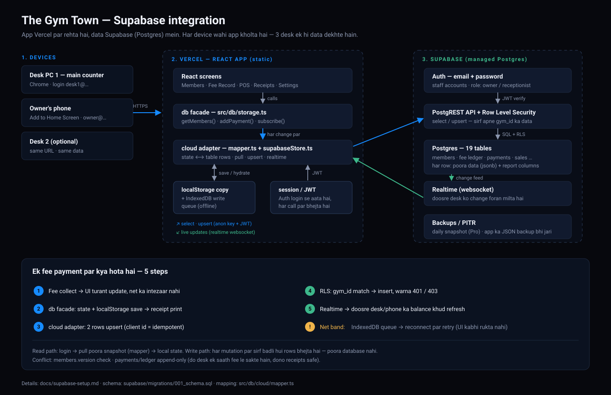
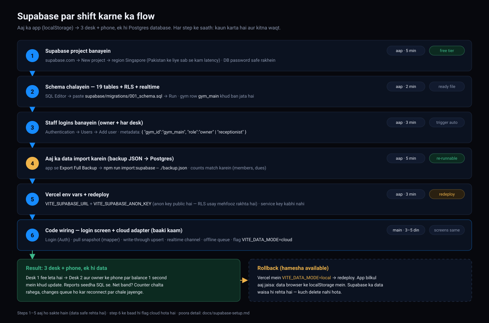

# Supabase (Postgres) — step-by-step, for this app

_Answering: “Supabase — kaise hoga?” This is the exact sequence, with the parts that are already built in the repo marked ✅._

---

## 0. The picture



_Khuli hui HD file: [`diagrams/supabase-architecture.svg`](./diagrams/supabase-architecture.svg)_

- The app still runs on **Vercel** exactly as it does today. Supabase is only a database + login service the browser talks to over HTTPS.
- No server to maintain: Supabase's API (PostgREST) is the backend.
- `localStorage` stays as the offline copy, so the counter still works when the internet drops.

**Setup ka flow (6 steps, kaun karta hai + kitna waqt):**



_Khuli hui HD file: [`diagrams/supabase-setup-flow.svg`](./diagrams/supabase-setup-flow.svg)_

**Already in the repo:**

| Piece | File |
| --- | --- |
| ✅ Full schema, RLS policies, realtime, triggers | `supabase/migrations/001_schema.sql` |
| ✅ `DatabaseState` ⟷ table-rows mapper (6 passing tests) | `src/db/cloud/mapper.ts`, `tests/integration/supabase-mapper.test.ts` |
| ✅ Import today's backup into Postgres | `scripts/import-backup-to-supabase.ts` (`npm run import:supabase`) |
| ⏳ Login screen + write-through adapter | next step, §6 |

---

## 1. Create the project (5 min)

1. <https://supabase.com> → **New project**.
2. Name `the-gym-town`, choose a strong database password, **region: Singapore** (lowest latency from Pakistan).
3. Wait ~2 minutes for provisioning.
4. **Project Settings → API**: copy
   - `Project URL` → `VITE_SUPABASE_URL`
   - `anon public` key → `VITE_SUPABASE_ANON_KEY`
   - `service_role` key → local machine only, for the import script. **Never** put it in Vercel or the app.

## 2. Create the schema

Supabase → **SQL Editor** → **New query** → paste the whole of
`supabase/migrations/001_schema.sql` → **Run**.

That creates 19 tables, indexes, the `updated_at` triggers, RLS on every table, and the `realtime` publication. It also inserts the gym row:

```sql
insert into public.gyms (id, name, address, city) values
  ('gym_main', 'The Gym Town', 'Hyder Chowk, Near Opposite Sultan Fast Food', 'Hyderabad')
on conflict (id) do nothing;
```

Two design decisions worth knowing:

- **`data jsonb`** on every table holds the *complete* original object, so nothing the app stores is lost even if a field is not a column.
- **The columns beside it** are just the ones SQL needs for reports: `balance_due`, `expiry_date`, `status`, `billing_month`, `total_amount`, …

## 3. Create the staff logins

Supabase → **Authentication → Users → Add user** (email + password):

| Email | Password | User metadata (Raw JSON) |
| --- | --- | --- |
| `owner@thegymtown.pk` | owner’s own | `{"gym_id":"gym_main","full_name":"Owner","role":"owner"}` |
| `desk1@thegymtown.pk` | shared desk password | `{"gym_id":"gym_main","full_name":"Bilal Tariq","role":"receptionist"}` |
| `desk2@thegymtown.pk` | shared desk password | `{"gym_id":"gym_main","full_name":"Desk 2","role":"receptionist"}` |

The trigger `handle_new_user` copies each user into `profiles` with their `gym_id` and `role`. That `gym_id` is what every RLS policy checks — a receptionist can only ever read/write `gym_main` rows.

Verify:

```sql
select id, gym_id, full_name, role from public.profiles;
```

## 4. Import the data you already have

On your own computer (needs Node):

```bash
# 1. In the app: Settings → Database → Export Full Backup  →  the-gym-town-backup.json
# 2. Then:
SUPABASE_URL="https://xxxx.supabase.co" \
SUPABASE_SERVICE_ROLE_KEY="eyJ...service_role..." \
npm run import:supabase -- ./the-gym-town-backup.json
```

It upserts **every** table in dependency order and prints row counts, then shows five members read back from Postgres. Re-running it is safe (upsert on `id`).

## 5. Point the app at it

Vercel → **Settings → Environment Variables** (Production *and* Preview):

```
VITE_SUPABASE_URL      = https://xxxx.supabase.co
VITE_SUPABASE_ANON_KEY = eyJ...anon...
```

The anon key is *meant* to be public — it can only do what RLS allows. Then redeploy.

## 6. How the app talks to the database (the remaining wiring)

The screens already call `db.getMembers()`, `db.addPayment()`, … only. So the integration is one new file plus a flag — **no screen changes**:

```
src/db/cloud/supabaseStore.ts     ← new: pull snapshot, write-through mutations, realtime
src/db/storage.ts                 ← picks "local" or "cloud" at boot from VITE_DATA_MODE
src/components/auth/LoginScreen.tsx ← new: email + password sign-in
```

**Read path (on login or app start)**

```ts
// pseudo, using @supabase/supabase-js
const { data } = await supabase.from('members').select('*').eq('gym_id', GYM_ID);
const tables = groupByTable(rows);                 // { members: [...], payments: [...] }
const state  = tablesToState(tables, db.getState()); // ✅ mapper already written + tested
db.hydrate(state);                                   // replaces memory + localStorage
```

**Write path (after every mutation)**

```ts
// after db.addPayment(...) the facade emits; the adapter upserts only what changed
await supabase.from('payments').upsert(stateToTables({ ...state, payments: [payment] }).payments);
```

Because columns exist only for reporting, an upsert is one row with `id`, a few columns and the full `data` object. Idempotent by design (client-generated ids), so retries are safe.

**Three desks, one dataset**

1. Each desk pulls the snapshot at login → identical starting point.
2. Every local change is pushed within ~1 second (debounced batch).
3. `supabase.channel('gymtown').on('postgres_changes', …)` pushes other desks’ changes into the local state → the UI updates without a refresh.
4. Conflict rule: `members.version` — the update is `where id = $1 and version = $2`; if zero rows change, the app re-reads the row and re-applies only the fields it touched. Money rows (payments, ledger) are **append-only**, so they never conflict at all — two desks can take fees at the same time and both receipts exist.

**Offline**: if a push fails, it goes into an IndexedDB queue with the client id and is retried on reconnect; the header shows “Offline — N changes queued”.

## 7. Reports that become trivial

Once the data is in Postgres, month-wise and profit reporting is one query instead of a JS loop:

```sql
-- outstanding dues per member
select roll_number, full_name, balance_due
from members
where gym_id = 'gym_main' and balance_due > 0 and removed_at is null
order by balance_due desc;

-- monthly fee collection
select billing_month,
       sum(amount) filter (where type = 'CHARGE')  as charged,
       sum(amount) filter (where type = 'PAYMENT') as collected
from member_fee_ledger
where gym_id = 'gym_main'
group by billing_month order by billing_month desc;

-- POS profit for this month
select date_trunc('month', sold_at) as month,
       sum(total_amount) as revenue,
       sum(total_cogs)   as cogs,
       sum(total_amount - total_cogs) as profit
from sales
where gym_id = 'gym_main'
group by 1 order by 1 desc;
```

## 8. Checklist before you cut over

- [ ] `select count(*) from members;` matches Settings → (backup counts) `members`
- [ ] `select sum(balance_due) from members where removed_at is null;` matches the app’s “total due”
- [ ] Log in as the receptionist and confirm `select * from members limit 5;` returns **only** that gym (RLS works)
- [ ] Try the same query as a user with a different `gym_id` → must return 0 rows
- [ ] Vercel has only `VITE_SUPABASE_URL` + `VITE_SUPABASE_ANON_KEY` — **no service key**
- [ ] Export a JSON backup before flipping `VITE_DATA_MODE=cloud`

## 9. Pitfalls people hit

| Symptom | Cause | Fix |
| --- | --- | --- |
| `new row violates row-level security policy` | signed-in user has no `profiles` row (metadata missing) | re-add the user with `{"gym_id":"gym_main"}` metadata, or insert the profile manually |
| `permission denied for table …` | RLS enabled but policies not created | re-run section 10 of the migration |
| Empty app after login | `VITE_*` vars added but no redeploy | redeploy on Vercel |
| `duplicate key … payments_gym_receipt_number_key` | two desks used the same receipt number | generate receipt numbers from a DB sequence (they already include the desk id — keep that) |
| Everything is 5 hours off | timestamps shown without timezone conversion | store UTC (default), render with `Asia/Karachi` |
| Deleted member disappears from history | someone ran a SQL `DELETE` | use the app’s soft remove (`removed_at`) |

## 10. Rollback

Nothing is destructive: keep `localStorage` as the offline copy and leave **Export Full Backup** in place. If anything looks wrong, set `VITE_DATA_MODE=local`, redeploy — the app is exactly as it is today, with the last synced data still in the browser.

---

### Cost & effort

- Supabase Free: 500 MB database, 50k monthly active users — a gym uses a few MB. Pro ($25/mo) adds daily backups + 7-day point-in-time recovery once the owner wants it.
- Engineering: ~3–5 focused days for §6 (login, adapter, realtime, offline queue) including testing on the three desks.
